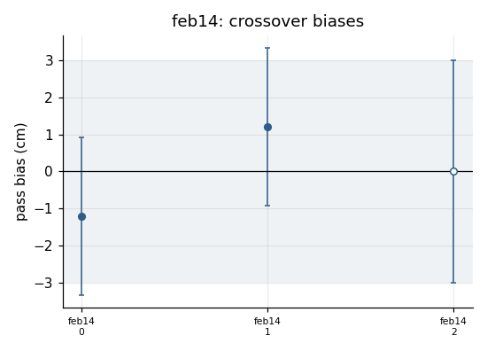
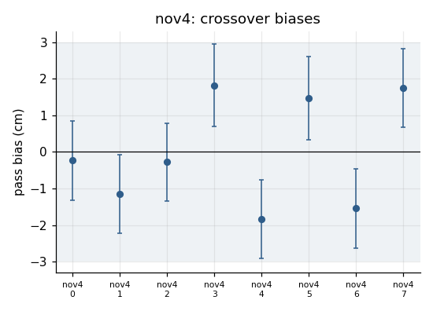
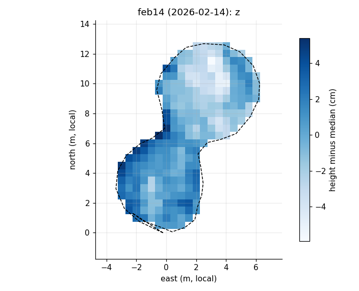
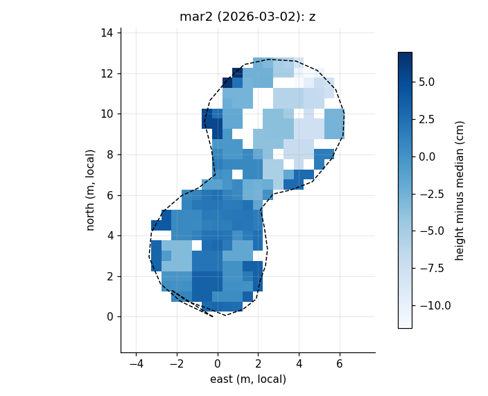
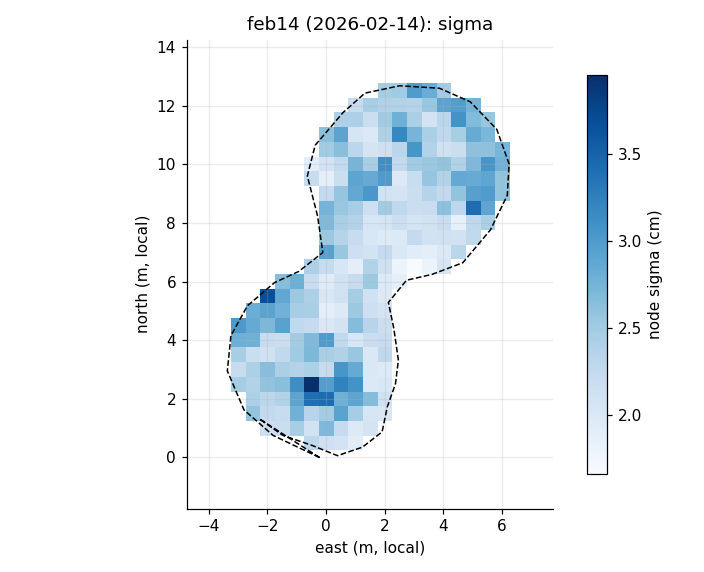
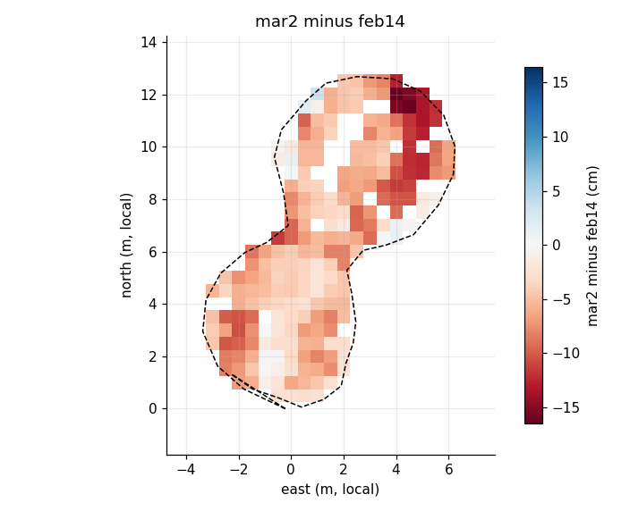
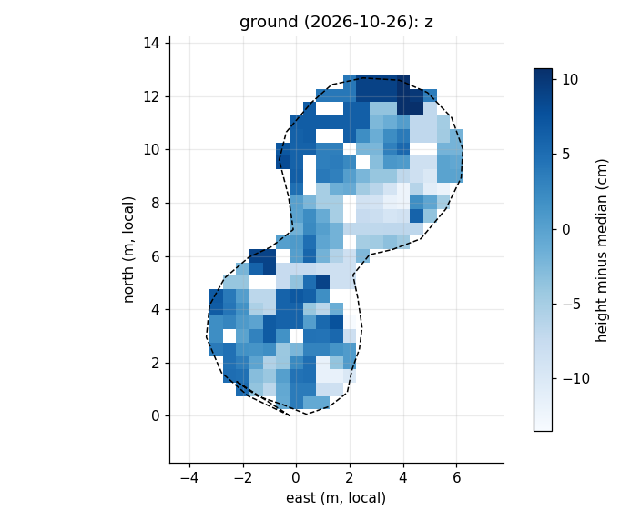

# Ice-Cube: a CUBE-derived surface and ice-growth estimator for the rink

`icecube/` turns RTK survey points of the rink into a height per grid node with an
uncertainty, a per-node "the samples disagree" flag, ice growth between dates with its
uncertainty, and a fill-to-level map. It is pure numpy, with matplotlib for the figures.

First, the honest part. Last winter's "Ice-Cube" (February-March 2026) was an
AI-written radius-binned inverse-distance mean with a z-score cut, called CUBE in
spirit only, and the "scientific report" that went with it was a spoof: a paper-shaped
document wrapped around a 178-point survey. That version had the idea (a node
estimator with uncertainty, after CUBE) without the machinery. This is the machinery,
built on the parts of CUBE the data can use, and tested.

## 1. Where it comes from

CUBE (Calder, B. R. and L. A. Mayer, 2003, "Automatic processing of high-rate,
high-density multibeam echosounder data", Geochemistry, Geophysics, Geosystems 4(6),
1048, doi:10.1029/2002GC000486) estimates a bathymetric surface on a grid of nodes.
Each sounding is propagated to nearby nodes with an uncertainty that grows with
distance, each node fuses its soundings sequentially (a scalar Kalman update), and a
sounding that disagrees with the node's current estimate beyond its uncertainty opens a
new hypothesis; at the end, a disambiguation rule picks the hypothesis to report.

What a backyard rink survey needs, and what it does not:

| CUBE part | here | why |
|---|---|---|
| Per-node sequential fusion, propagated sounding uncertainty, outputs z / sigma / n | **kept** | it is the right estimator for scattered RTK points with their own sigmas |
| Uncertainty inflation with distance to the node | **kept, simplified** | CUBE's form is built from IHO survey orders; a 1 cm pole needs a plain slope allowance |
| Inconsistency test between a sounding and the node | **kept as a flag and counter** | the tool must say where samples disagree |
| Multiple hypotheses and disambiguation | **dropped** | there is one ice surface per cell. Snow on ice, slush and pole sink were invented by agents last year to explain scatter that was RTK wander. If two surfaces ever appear, the flag counts them |
| Crossover adjustment in front of the gridder | **added** | the dominant error is a slowly varying, pass-wide vertical bias of the RTK solution: a few cm over minutes with a CORS 25 km away, about a third of that with the home base. One constant bias per pass, solved from overlaps, with a zero-mean prior |
| Time axis: one grid for every date, growth with combined sigma, volume, fill-to-level | **added** | tracking ice growth is the point |

## 2. The error model

A point `i` in pass `p` has height

    z_i = h(x_i, y_i) + b_p + e_i

with `h` the surface, `b_p` the pass bias (RTK wander, taken as constant within a pass)
and `e_i` per-point noise with sigma `sz_i` (from the file's vertical accuracy, or a
default, 1.5 cm). A pass is a stretch of points that plausibly share one bias: it ends
at a time gap, a horizontal jump, a loss of fix, a marker point, or after a maximum
duration. Surveys with no time (last season's GeoJSON) are segmented by jumps only.

### Crossover adjustment (`icecube/crossover.py`)

Points of each pass are averaged in cells of `crossover_radius` (0.5 m), with a
variance no smaller than the best single point's (4 Hz epochs are not independent, so
a cell of 90 of them is not 90 measurements); pass-cells of different passes within
that distance form an observation

    z_i - z_j = b_p - b_q + v,     var(v) = sz_i^2 + sz_j^2 + (slope * d_ij)^2

where `d_ij` is the horizontal separation and `slope` (m/m) allows for the surface not
being flat between them. Only differences are observable, so each bias gets an
independent zero-mean Gaussian prior with sigma `wander_prior` (3 cm). The weighted
least squares with the prior is

    (A^T W A + I / prior^2) b = A^T W dz,    cov = (A^T W A + I / prior^2)^-1

A pass with no overlaps gets exactly zero and keeps the prior sigma. A pass whose
posterior sigma stays above `separable_ratio` x prior (0.8), or with fewer than
`min_pairs` (3) overlaps, is reported as **not separable, held at zero**, and its
sigma is the prior (the uncertainty of "zero" is the expected wander, not the
posterior of an estimate that was discarded). Pairs
differing by more than `max_dz` (25 cm: a deck edge, a step) are dropped before the
solve; pairs with a normalised residual above `reject_sigma` (4) are dropped and the
system solved once more. The report gives the chi-square per degree of freedom, the
number of connected components, and per pass: bias, posterior sigma, pair count, and
whether the bias is distinguishable from zero.

Why the prior: `analysis/survey_wander.py` fitted a piecewise-linear bias in time to
crossovers and "invented about 15 cm of drift on the stable Nov session". Without a
prior the datum is free and weakly connected passes drift to fit noise. With it, the
tool's answer to too little overlap is zero, labelled as such.

### Node estimator (`icecube/nodes.py`)

Nodes at `x0 + i*cell`, `y0 + j*cell` (0.5 m). A sounding feeds every node within
`capture_radius` (0.75 m), with variance

    v = sz^2 + (slope * (d + sh))^2

(`d` distance to the node, `sh` horizontal sigma, `slope` the same allowance as above:
the surface may differ from the sounding by `slope` metres per metre, one sigma). The
node's estimate is the weighted mean of its soundings with weights `1/v`, applied in
time order:

    z = sum(z_i / v_i) / sum(1 / v_i),          var_noise = 1 / sum(1 / v_i)
    var_bias = sum_p (W_p / W)^2 * sb_p^2       (W_p = weight from pass p, sb_p its bias sigma)
    sigma = sqrt(var_noise + var_bias)

The bias part does not average down inside a pass: ten points from one pass are not
ten independent measurements of the datum. `sb_p` is the crossover posterior sigma (the
prior where nothing was solved). The surface as a whole gets a datum sigma
`sqrt(sum_p (n_p/n)^2 sb_p^2)` by the same rule.

Inconsistency: before a sounding is fused, if the node has an estimate and

    |z_i - z| > k_sigma * sqrt(var_noise + v_i + var_bias + (1 - 2 W_p/W) * sb_p^2)

(k = 3; `W_p` the weight the node already holds from the sounding's own pass, so a
sounding from a new pass adds its full bias variance and one from the pass that makes
up the whole node adds none, the shared bias cancelling), the node's flag counter goes
up. The sounding is still fused: one surface is the assumption, and the counter says
where it looked wrong. The report lists the flagged nodes with their worst
disagreement in sigmas. The test has a floor: with a pass bias sigma of 3 cm it cannot
see a second surface closer than about `k * sqrt(2) * sb` = 13 cm, with 1 cm about
4 cm; "nothing flagged" is a statement at that level.

### Growth (`icecube/growth.py`)

Two surfaces on the same grid: `dz = z_b - z_a`, `sigma = sqrt(sigma_a^2 + sigma_b^2)`
where both have soundings (and inside the outline). The mean growth over the mask
gets `sqrt(f * sum(sigma^2) / n^2 + datum_a^2 + datum_b^2)` (the weighted mean,
`sqrt(f / sum(1/sigma^2) + ...)`), where `f` is the number of nodes each sounding
feeds (about 7 with a 0.75 m capture on a 0.5 m grid: neighbouring nodes are not
independent). Node noise averages down over the nodes, the datum part does not, and
in practice the datum part is nearly all of it. Volume above the older surface, fill-to-level (water level =
the 99th percentile of the surface + 5 cm, or a given level) and relief statistics are
derived from the same arrays. Surfaces in different frames are refused unless an
explicit offset is given: the home base and the CORS network frames differ by about a
metre here, which would otherwise look like a metre of ice.

## 3. How to run

    cp icecube.example.toml my-rink.toml      # fill in; keep it out of the repository
    python3 -m icecube run my-rink.toml [--out DIR] [--set grid.cell=0.25 ...]
    python3 -m unittest discover icecube/tests

`--out` and `--set section.key=value` override the config (arguments take priority).

The config gives the site origin (UTM metres; `site_config = "analysis/site_config.json"`
reuses the siting scripts' origin so both tools share local coordinates), sigma
defaults, the grid, an optional outline polygon, the surveys and the growth pairs.
Each `[[surveys]]` entry has an `id`, a `date`, a `frame`, a `reader`, filters
(`keep_quality`, `exclude_remarks`, `drop_seq`, `z_min`/`z_max`, `offset`,
`pole_height`) and a `pass_rule` (`gap_s`, `jump_m`, `markers`, `fixed_only`, `max_s`,
`settle_s`, `min_points`). `surface` groups several surveys into one surface (two
ground-survey days); `role = "validation"` runs passes and crossover without masks or
growth. Readers:

- `swmaps_geojson`: SW Maps GeoJSON, Point features (z, REMARKS) or Polygon vertices
  (`geometry = "polygon"`, `names = ["rink"]`). No time, no sigma.
- `swmaps_csv`: SW Maps CSV export (Latitude, Longitude, Elevation, Time, Fix ID,
  Horizontal/Vertical Accuracy, Remarks).
- `enu_csv`: a 4 Hz E/N/U table already in local metres with GST sigmas (columns
  `utc, quality, E_m, N_m, U_m, gst_sig_lat, gst_sig_lon, gst_sig_alt`; a private
  rover-test script writes one). The logger app's format will be added when it exists.

Outputs per run: `summary.md`, `run.json`, `surface_<name>.npz` (z, sigma, n, flags,
last update, passes per node, grid), `growth_<a>_<b>.npz`, pass / crossover / flagged
node tables, and PNG maps in local metres from the origin (height, sigma, count, flags,
points by pass, biases with error bars, crossover residuals, growth). The code never
prints an absolute coordinate; the UTM projection (Krueger series, pure numpy) is only
there to turn the files' lat/lon into local metres.

## 4. Worked example

Private data, relative numbers. Last season (Jan 9 outline, Feb 14, Mar 2; all via the
state CORS network, one frame) and this fall (Oct 18 + 26 ground; Nov 4 home-base
walk for the crossover validation only). Settings: cell 0.5 m, capture 0.75 m, k = 3,
prior 3 cm, slope 0.05 m/m on ice and 0.10 on the lawn. Point counts: Jan 9 outline 35
vertices; Feb 14 176 points (deck reference and the closing deck shot dropped); Mar 2 71
(reference dropped); October 304 fixed points; Nov 4 11133 fixed epochs after dropping
the first 90 s of every fix.

### Passes and crossover

Last season's files have no time, so passes split at horizontal jumps > 3 m: Feb 14
gives 3 passes (109, 66, 1 points), Mar 2 two (51, 20). Feb 14 has 25 overlapping
pass-cells in two components, Mar 2 four, Jan 9 none.

| surface | pairs | biases (cm) | posterior sigma | verdict |
|---|---|---|---|---|
| Jan 9 outline | 0 | 0 | 3.0 (prior) | not separable, held at zero |
| Feb 14 | 25 | -1.3, +1.3, 0 | 2.1, 2.1, 3.0 | consistent with zero; third pass not separable |
| Mar 2 | 4 | +1.2, -1.2 | 2.2 | consistent with zero |
| Oct ground (5 passes) | 13 | +0.5, +2.6, -3.1, 0, 0 | 1.9 | consistent with zero; two short passes not separable |

That is the predicted result: with an edge loop and an interior that barely overlap,
the posterior sigma is just under the prior and the honest answer is "about zero,
+-2 cm". Applying these small biases changes the Feb 14 point relief inside the outline
from 12.0 to 14.5 cm and the Feb-Mar mean by 1.4 cm, both inside the uncertainty; the
chi-square per degree of freedom of 2-3 says the pairs carry as much ice slope as bias.

**Nov 4 validation.** The 65-minute home-base walk, fixed epochs only, split into 8
passes of 1-10 minutes (a pass ends at any loss of fix, and after 10 minutes). 783
pass-cell pairs, 21 dropped beyond 25 cm (deck edge, steps), 82 by the 4-sigma test:

All eight biases are within 2 sigma of zero (range -1.8 to +1.8 cm, sigma 1.1 cm, rms
1.4 cm). On the same session the piecewise-linear fit in `survey_wander.py` found
15 cm of drift. The prior and the per-pass constant do what they were put there for.

### Surfaces

Inside the Jan 9 outline:

| surface | nodes | soundings/node (median) | node sigma p5 / median / p95 (cm) | relief max-min (cm) | sd (cm) | flagged nodes |
|---|---|---|---|---|---|---|
| Jan 9 outline | 87 | 1 | 3.4 / 3.9 / 4.9 | 27.2 | 8.1 | 0 |
| Feb 14 | 261 | 3 | 1.9 / 2.4 / 3.0 | 11.4 (points 12.0-14.5) | 2.2 | 0 |
| Mar 2 | 231 | 1 | 2.2 / 3.4 / 4.5 | 18.5 (points 16.8) | 3.7 | 0 |
| Oct ground | 238 | 1 | 2.5 / 4.2 / 7.2 | 24.2 | 5.8 | 1 |

The relief numbers reproduce the earlier point-level check (27.2 cm for the Jan 9
outline, 12-13 cm for Feb 14, 17 cm for Mar 2): the outline was a perimeter with 27 cm
of relief, and by mid-February the surveyed ice was within 12-14 cm. Node sigmas are
2-4 cm on the ice, dominated by the unresolved pass bias, and 4 cm on the lawn where
single soundings 1-2 m apart leave the slope term in charge.

### Growth

| pair | nodes | mean (cm) | sigma of the mean (cm) | node sigma median (cm) | sd over nodes (cm) |
|---|---|---|---|---|---|
| Jan 9 outline -> Feb 14 (edge nodes only) | 87 | +13.6 | 3.6 | 4.7 | 6.9 |
| Feb 14 -> Mar 2 | 231 | -5.8 (-4.4 +- 3.3 with biases held at zero) | 2.4 | 4.1 | 3.4 |

Mar 2 is 4-6 cm below Feb 14 with a 2.4-3.3 cm sigma on the mean, so last season's
two surveys show a loss of about 1-8 cm, not growth, and the earlier point-level
estimate (-3.4 cm) is inside that. The sigma of the mean is almost entirely datum
(pass bias): more nodes would not shrink it, more crossovers would. That is the practical lesson for
the coming winter: survey in passes that overlap (a closed loop and a crossing line
every ten minutes), so the adjustment has something to solve.

October ground, same outline: 9.6 m^3 of water to level it at the siting rule (99th
percentile + 5 cm), mean depth 16 cm, max 29 cm.

### What the inconsistency flag did

Nothing on the three rink surfaces (0 nodes at k = 3), one node on the October lawn
(two soundings 3.6 sigma apart). Read that with the floor in mind: last season's pass
bias sigmas are 2-3 cm, so the test could only have seen disagreements of a
decimetre or more, which is the whole Feb 14 relief. On the Nov 4 yard walk, gridded
only for the record, it fired on 452 of 1537 nodes: the deck repeat spot (687 soundings from 6 passes, deck
top against ground and one stale-correction visit) and the steps and edges around the
yard, which really are two surfaces. In the synthetic tests a planted +10 cm second
surface is flagged at more than 80 % of the crossing nodes when the pass bias sigma is
0.5 cm (the home-base case), a +20 cm one when it is 3 cm (last season's case), a
+10 cm one is then missed, and a bias-free session gets no invented bias.

## 5. Limits

- One bias per pass. Wander inside a pass is noise to this tool; keep passes short
  (`max_s`) when there is time, and overlap them.
- The slope allowance is one number for the whole surface. It is right for ice and
  rough for a lawn with steps; the flag table shows where.
- The frame check is by label. Two surveys labelled the same frame but on different
  base coordinates will be differenced; store the frame with every survey.
- The flag counter (not the surface) depends slightly on the order soundings arrive
  in, because it is a running test.
- No basemap, no absolute coordinates, by design.
